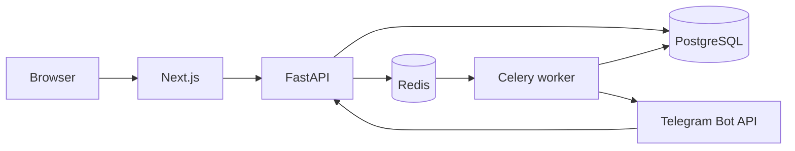

# Architecture

The browser talks only to Next.js. Next.js proxies `/api` to FastAPI, so the session cookie stays on the site origin. Telegram calls the API host directly at `/api/v1/webhooks/telegram`.

Imports, sends, reconciliation, retention, and the analytics snapshot run as jobs. The API reads metrics with SQL at request time. The snapshot job does not replace those queries.

Phone numbers are encrypted. A separate HMAC is stored for duplicate detection. Invite links are stored only after Telegram returns them. Campaign configuration is saved before any provider is contacted, and eligibility is evaluated again inside the send job.
